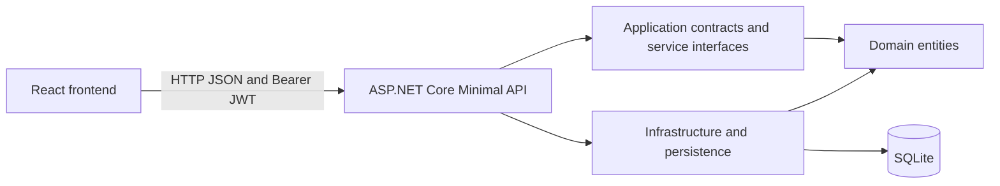

# StoreOps

StoreOps is a small-retailer inventory and order-management application. It combines an ASP.NET Core 10 Minimal API, a SQLite database managed by Entity Framework Core migrations, and a React + TypeScript frontend built with Vite.

The backend separates domain entities, application contracts, infrastructure, and HTTP endpoints. The frontend is organized by feature, with separate auth, dashboard, product, and order modules.

## Features

- Product catalog with categories, filtering, sorting, pagination, create, edit, and delete.
- Inventory counts and low-stock dashboard summary.
- Order APIs for creating orders, checking stock, and fulfilling or cancelling pending orders.
- Role-based JWT authentication with short-lived access tokens and rotating, revocable refresh tokens.
- EF Core migrations, startup sample data, health checks, structured request logging, and API integration tests.

## Architecture



### Backend projects

| Project | Responsibility |
|---|---|
| `src/backend/Domain` | Business entities and enums. Has no project dependencies. |
| `src/backend/Application` | Request/response contracts and application service interfaces. References Domain. |
| `src/backend/Infrastructure` | EF Core DbContext and migrations, SQLite setup, seeding, and authentication implementations. |
| `src/backend/Api` | Minimal API endpoints, middleware, dependency injection, authentication policies, and OpenAPI. |
| `tests/StoreOps.Api.Tests` | xUnit integration tests using `WebApplicationFactory` and SQLite in-memory. |

Most current catalog and order handlers use `StoreOpsDbContext` directly from endpoint files. See the [backend architecture and feature development guide](docs/backend-architecture.md) for dependency rules, model details, and step-by-step instructions for adding features and entities.

### Frontend structure

```text
src/frontend/src/
  app/                 App shell and shared store-data hook
  features/
    auth/              Login
    dashboard/         Overview and store metrics
    orders/            Order list and status actions
    products/          Catalog, add/edit modal, delete confirmation
  lib/                 Auth-aware HTTP client and token refresh
  shared/              Shared types and formatting
```

## Requirements

- .NET 10 SDK
- Node.js supported by Vite 8 (Node.js 20.19+ or 22.12+)
- npm
- Git
- `dotnet-ef` 10.x for creating or applying migrations from the CLI

The app uses SQLite locally; no separate database server is required.

## First-time setup

Run commands from the repository root in PowerShell:

```powershell
Set-Location "C:\envkit\projects\ASP.NET CORE"
```

### 1. Configure local secrets

The API requires a JWT signing key and uses the bootstrap email/password to create the first Admin account when it does not already exist. Keep these values in .NET User Secrets, not in source files.

```powershell
$api = ".\src\backend\Api\StoreOps.Api.csproj"
$jwtSigningKey = [Convert]::ToBase64String([Security.Cryptography.RandomNumberGenerator]::GetBytes(48))

dotnet user-secrets set "Jwt:SigningKey" $jwtSigningKey --project $api
dotnet user-secrets set "BootstrapAdmin:Email" "admin@storeops.local" --project $api
dotnet user-secrets set "BootstrapAdmin:Password" "<choose-a-strong-local-password>" --project $api
```

Replace the password placeholder with a unique password before running the API. The bootstrap password is used only when creating the initial account; changing the secret later does not change an existing user's password. Store production credentials in your deployment secret manager.

Non-secret JWT issuer/audience defaults and the SPA CORS origin are in `src/backend/Api/appsettings.json`. Override them for other environments using configuration or environment variables such as `Jwt__Issuer`, `Jwt__Audience`, `Jwt__SigningKey`, `ConnectionStrings__StoreOps`, and `SpaOrigin`.

### 2. Restore and build the backend

```powershell
dotnet restore ".\StoreOps.slnx"
dotnet build ".\StoreOps.slnx"
```

### 3. Install frontend dependencies

```powershell
Set-Location ".\src\frontend"
npm ci
Set-Location "..\.."
```

## Run locally

Use two PowerShell terminals, both in the repository root.

**Terminal 1: API**

```powershell
Set-Location "C:\envkit\projects\ASP.NET CORE"
$env:ASPNETCORE_ENVIRONMENT = "Development"
dotnet run --project ".\src\backend\Api\StoreOps.Api.csproj" --no-launch-profile --urls "http://localhost:5000"
```

On startup, the API applies pending migrations and seeds the sample categories/products. It creates the bootstrap admin if both bootstrap secrets are configured and no matching user exists.

**Terminal 2: frontend**

```powershell
Set-Location "C:\envkit\projects\ASP.NET CORE\src\frontend"
npm run dev -- --host 127.0.0.1
```

Open [http://127.0.0.1:5173](http://127.0.0.1:5173) and sign in with the email/password configured above. Vite proxies `/api` and `/health` to `http://localhost:5000`.

Health check: [http://localhost:5000/health](http://localhost:5000/health)
OpenAPI document in Development: [http://localhost:5000/openapi/v1.json](http://localhost:5000/openapi/v1.json)

The default SQLite file is created under `src/backend/Api/data/`. It is local runtime data and is intentionally excluded from Git.

## Authentication and roles

Login is at `POST /api/v1/auth/login`. It returns an access token, refresh token, and `expiresIn` in seconds. Send the access token on protected API requests:

```http
Authorization: Bearer <access-token>
```

Access tokens expire after 15 minutes. Refresh tokens last 7 days, are stored hashed in the database, and rotate when refreshed. Reuse of a revoked refresh token triggers revocation of active refresh tokens for the user.

| Role | Product management | Orders | Reports |
|---|---:|---:|---:|
| `Admin` | Yes | Yes | Yes |
| `Manager` | Yes | Yes | Yes |
| `Fulfillment` | No | Yes | No |
| `Viewer` | No | No | Yes |

Policies are enforced by the API. Hiding a screen or button in the frontend is not an authorization boundary.

## API overview

All application endpoints use the `/api/v1` prefix. Except for `/health`, login, and refresh, endpoints require authentication.

| Method | Route | Authorization | Purpose |
|---|---|---|---|
| `GET` | `/health` | Anonymous | API and database health |
| `POST` | `/auth/login` | Anonymous | Sign in |
| `POST` | `/auth/refresh` | Anonymous | Rotate refresh token |
| `POST` | `/auth/logout` | Authenticated | Revoke refresh token |
| `GET` | `/categories` | Authenticated | List categories |
| `POST` | `/categories` | `ManageProducts` | Create category |
| `GET` | `/products` | Authenticated | List/search/filter/sort products |
| `GET` | `/products/{id}` | Authenticated | Get product details |
| `POST` | `/products` | `ManageProducts` | Create product |
| `PUT` | `/products/{id}` | `ManageProducts` | Update product |
| `DELETE` | `/products/{id}` | `ManageProducts` | Delete product if not referenced by an order |
| `GET` | `/orders` | `ManageOrders` | List orders |
| `POST` | `/orders` | `ManageOrders` | Create order and deduct inventory |
| `PATCH` | `/orders/{id}/status` | `ManageOrders` | Fulfill or cancel a pending order |
| `GET` | `/reports/dashboard` | `ViewReports` | Store metrics |

Product list query parameters include `page`, `pageSize`, `search`, `categoryId`, `sortBy`, and `descending`. Page size is capped at 100. Order list supports `page`, `pageSize`, and `status`.

Order creation accepts product IDs and quantities. The API validates available stock and makes order creation and stock deduction transactional. Cancelling a pending order restores its stock. The backend supports creating orders, but the current frontend does not yet include an order-creation screen.

API errors use HTTP status codes with Problem Details or validation-problem response shapes where applicable. Common statuses include `400` validation error, `401` unauthenticated, `403` forbidden, `404` not found, and `409` conflict.

## Database and migrations

EF Core migrations are stored in `src/backend/Infrastructure/Persistence/Migrations`. The runtime applies migrations at startup. Review and commit migrations when changing the model.

Install the EF CLI if needed:

```powershell
dotnet tool install --global dotnet-ef --version 10.0.14
```

Add a migration and update the local database from the repository root:

```powershell
dotnet ef migrations add AddYourFeature `
  --project ".\src\backend\Infrastructure\StoreOps.Infrastructure.csproj" `
  --startup-project ".\src\backend\Api\StoreOps.Api.csproj" `
  --output-dir "Persistence\Migrations"

dotnet ef database update `
  --project ".\src\backend\Infrastructure\StoreOps.Infrastructure.csproj" `
  --startup-project ".\src\backend\Api\StoreOps.Api.csproj"
```

Check the `ConnectionStrings__StoreOps` environment variable before applying migrations if you intend to target a database other than the local default.

## Tests and quality checks

From the repository root:

```powershell
dotnet test ".\StoreOps.slnx"
```

Frontend production build and lint:

```powershell
Set-Location ".\src\frontend"
npm run build
npm run lint
```

The API integration tests use an in-memory SQLite connection and override normal development configuration. Add tests for successful requests, validation/conflict cases, and allowed/denied roles when adding an endpoint.

## Add a backend feature or model

Follow the detailed example in the [backend architecture guide](docs/backend-architecture.md). In brief:

1. Add the entity and domain rules to `Domain/Entities`.
2. Add request/response contracts under `Application/Contracts/<Feature>`.
3. Add a `DbSet` and EF model configuration to `StoreOpsDbContext`.
4. Add a feature endpoint group under `Api/Endpoints` and map it in `Program.cs`.
5. Apply authentication and authorization policies explicitly.
6. Create/review an EF migration.
7. Add integration tests for expected and failure behavior.
8. Run `dotnet build` and `dotnet test`, then update this README's API table if the public contract changed.

Keep Domain independent, use DTOs instead of returning EF entities, pass `CancellationToken` through async work, use no-tracking projections for reads, and make multi-row business operations transactional when they must be atomic.

## Configuration and deployment notes

- `ConnectionStrings:StoreOps`: SQLite connection string; defaults to `Data Source=data/storeops.db`.
- `Jwt:Issuer`, `Jwt:Audience`, `Jwt:SigningKey`: JWT token configuration; signing key must be at least 32 UTF-8 bytes.
- `BootstrapAdmin:Email`, `BootstrapAdmin:Password`: initial admin creation only; configure both or neither.
- `SpaOrigin`: allowed frontend origin for CORS; defaults to `http://localhost:5173`.
- HSTS and HTTPS redirection are enabled outside Development.
- Request logging uses Serilog. Health checks include the database context.
- OpenAPI JSON is available in Development. Swagger UI, Docker/Compose, and CI/CD workflows are not currently configured in this repository.

See [docs/backend-architecture.md](docs/backend-architecture.md) for complete backend structure, endpoint behavior, data relationships, operational details, and migration/feature examples.

## License

This project is distributed under the MIT License. See [LICENSE](LICENSE).
