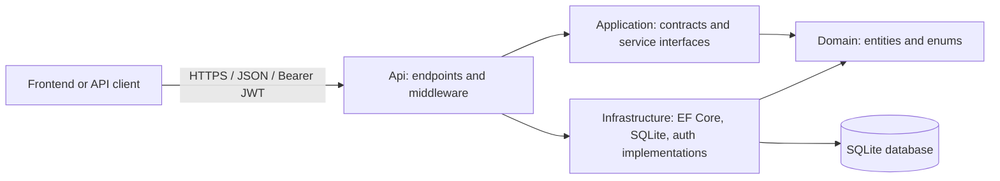

# StoreOps Backend Architecture and Developer Guide

This guide describes the backend as it currently exists and gives a repeatable workflow for adding entities, database tables, API features, authorization, and tests.

## 1. Backend at a glance

StoreOps is a .NET 10 ASP.NET Core Minimal API with four projects and an API integration-test project. It uses Entity Framework Core with SQLite, JWT bearer authentication, BCrypt password hashes, refresh-token rotation, Serilog request logging, Problem Details error handling, and EF Core migrations.

The design is Clean Architecture-inspired, with separate Domain, Application, Infrastructure, and Api projects. The current implementation is intentionally lightweight: most catalog and order use cases are implemented in endpoint mapping files and interact with the DbContext directly. There is not yet a general repository, command-handler, or application-service layer for every feature.



### Dependency direction

Current project references:

```text
Domain          -> no project references
Application     -> Domain
Infrastructure  -> Domain, Application
Api             -> Application, Infrastructure
Api.Tests       -> Api (and accesses referenced project types through it)
```

Keep Domain independent. Application may depend on Domain, but not on EF Core, ASP.NET Core endpoint types, or Infrastructure implementations. Infrastructure implements application-facing abstractions and owns data-access details. Api is the composition root: it configures DI and middleware and maps HTTP endpoints.

For a small feature, the existing endpoint-to-DbContext pattern is consistent with the codebase. If the feature gains substantial business logic, move its use cases behind an Application service interface and put the implementation in Infrastructure (or in Application if it needs no outer-layer dependency). Keep endpoint handlers focused on HTTP concerns and orchestration.

## 2. Repository map

```text
StoreOps.slnx
src/backend/
  Domain/
    Entities/                 Business entities and enums
  Application/
    Contracts/                Request/response DTOs organized by feature
    Services/                  Application-facing service interfaces
  Infrastructure/
    Auth/                      Authentication implementations and repositories
    Persistence/
      StoreOpsDbContext.cs     EF Core DbSets and Fluent API model configuration
      StoreOpsDbContextFactory.cs
      Migrations/              Committed EF Core schema migrations
    Seeding/                   Startup migrations and idempotent initial data
  Api/
    Endpoints/                 Minimal API route groups by feature
    Program.cs                 DI, middleware, auth policies, health and mapping
    Controllers/WeatherForecastController.cs
    WeatherForecast.cs         Unused template leftovers; MVC controllers are not registered
tests/
  StoreOps.Api.Tests/          xUnit API integration tests and WebApplicationFactory
```

Existing API feature files are `AuthEndpoints.cs`, `CategoryEndpoints.cs`, `ProductEndpoints.cs`, `OrderEndpoints.cs`, and `ReportEndpoints.cs`. Contracts live under `Application/Contracts/<Feature>/`. Domain data is under `Domain/Entities/`.

## 3. Request and startup flow

### Startup

`Api/Program.cs`:

1. Configures Serilog.
2. Registers `StoreOpsDbContext` with the configured SQLite connection string.
3. Binds and validates JWT options at startup.
4. Registers token, password, user repository, and auth services.
5. Configures JWT bearer authentication and role-based authorization policies.
6. Configures the auth rate limiter, CORS, Problem Details, OpenAPI, and database health check.
7. Configures request logging, exception handling, production HSTS/HTTPS redirection, security headers, routing, CORS, rate limiting, authentication, and authorization.
8. Runs `SeedStoreOpsAsync`, which safely adopts the original `EnsureCreated` database schema when applicable, applies migrations, and adds sample categories/products and the configured bootstrap admin if absent.
9. Maps `/health` and the feature endpoint groups.

The middleware and mapping order is significant. For example, authentication must run before authorization, and the auth routes use `.AllowAnonymous()` to override the global fallback authorization policy.

### Request handling

An endpoint binds route/query/body values, validates input, performs its use case, and returns a Minimal API result. Endpoint parameters such as `StoreOpsDbContext` and `CancellationToken` are provided through ASP.NET Core dependency injection and request cancellation. EF queries for reads generally use `AsNoTracking()`. API responses use DTOs instead of returning EF entities.

Errors use standard HTTP statuses and Problem Details/Validation Problem responses where implemented. Examples include `401` for invalid authentication, `403` for a missing role, `404` for missing resources, `409` for duplicate/conflicting operations, and `400` validation problems. Unexpected exceptions are logged and handled by the global exception handler.

Problem Details responses use the standard `type`, `title`, `status`, and optional `detail` fields. Validation problems include an `errors` object keyed by input field. Do not return stack traces or internal exception details to clients.

## 4. Current data model

| Entity | Important fields | Relationships / behavior |
|---|---|---|
| `Category` | `Id`, `Name` | One category has many products. Name is unique. |
| `Product` | `Id`, `CategoryId`, `Sku`, `Name`, `Description`, `UnitPrice`, `StockQuantity`, `CreatedAtUtc` | Belongs to a category. SKU is unique. Category deletion is restricted. |
| `Order` | `Id`, `Status`, `CreatedAtUtc`, `FulfilledAtUtc` | Has order items. Status is stored as a string. |
| `OrderItem` | `Id`, `OrderId`, `ProductId`, `ProductName`, `Quantity`, `UnitPrice` | Belongs to an order and refers to a product. Captures product name and price at order time. Order deletion cascades to its items; product deletion is restricted while referenced. |
| `User` | `Id`, `Email`, `NormalizedEmail`, `PasswordHash`, `IsActive`, `CreatedAtUtc` | Has roles and refresh tokens. Normalized email is unique. |
| `UserRole` | `UserId`, `Role` | Composite key; role rows cascade with the user. |
| `RefreshToken` | `UserId`, `FamilyId`, `TokenHash`, `ReplacedByTokenHash`, `CreatedAtUtc`, `ExpiresAtUtc`, `RevokedAtUtc`, `ConcurrencyStamp` | Stores only token hashes; unique token hash and concurrency stamp support rotation/reuse detection. |

`StoreOpsDbContext.OnModelCreating` is the authoritative EF model configuration. Keep indexes, precision, key configuration, relationship behavior, conversions, and property constraints there or in dedicated `IEntityTypeConfiguration<T>` classes if the model grows.

Money fields use decimal values configured with precision `(12, 2)`. Timestamps use UTC property names/conventions such as `CreatedAtUtc`. The current `OrderStatus` values are `Pending`, `Fulfilled`, and `Cancelled`.

## 5. Existing API surface

All routes below are under `/api/v1`. JSON uses the ASP.NET Core web defaults (camel-cased property names). Protected calls require `Authorization: Bearer <access-token>`.

| Method | Route | Access | Purpose |
|---|---|---|---|
| `GET` | `/health` | Anonymous | Application and database health check |
| `POST` | `/auth/login` | Anonymous, rate-limited | Issue access and refresh tokens |
| `POST` | `/auth/refresh` | Anonymous, rate-limited | Rotate a refresh token |
| `POST` | `/auth/logout` | Authenticated | Revoke the supplied refresh token |
| `GET` | `/categories` | Authenticated | List categories |
| `POST` | `/categories` | `ManageProducts` | Create a category |
| `GET` | `/products` | Authenticated | Search, filter, sort, and paginate products |
| `GET` | `/products/{id}` | Authenticated | Get a product |
| `POST` | `/products` | `ManageProducts` | Create a product |
| `PUT` | `/products/{id}` | `ManageProducts` | Replace editable product fields |
| `DELETE` | `/products/{id}` | `ManageProducts` | Delete an unreferenced product |
| `GET` | `/orders` | `ManageOrders` | List orders, optionally filtering by status |
| `POST` | `/orders` | `ManageOrders` | Create a pending order and deduct stock |
| `PATCH` | `/orders/{id}/status` | `ManageOrders` | Fulfill or cancel a pending order |
| `GET` | `/reports/dashboard` | `ViewReports` | Return dashboard aggregates |

Product listing query parameters: `page` (default 1), `pageSize` (default 20, clamped to 1-100), `search`, `categoryId`, `sortBy` (`price`, `stock`, `sku`, or default name), and `descending`.

Order listing query parameters: `page` (default 1), `pageSize` (default 20, clamped to 1-100), and `status` (`Pending`, `Fulfilled`, or `Cancelled`).

Login accepts `{"email":"admin@example.local","password":"<password>"}` and returns:

```json
{
  "accessToken": "<JWT>",
  "refreshToken": "<opaque-refresh-token>",
  "expiresIn": 900
}
```

Refresh and logout accept `{"refreshToken":"<opaque-refresh-token>"}`. Refresh returns a new token response and invalidates the previous refresh token. The authentication rate-limit policy permits 10 requests per client IP per minute.

Paginated responses use:

```json
{
  "items": [],
  "page": 1,
  "pageSize": 20,
  "totalCount": 0
}
```

Product creation and update use `SaveProductRequest`:

```json
{
  "categoryId": "00000000-0000-0000-0000-000000000000",
  "sku": "BEV-003",
  "name": "House blend coffee",
  "description": "Medium roast",
  "unitPrice": 8.5,
  "stockQuantity": 10
}
```

Order creation uses:

```json
{
  "items": [
    { "productId": "00000000-0000-0000-0000-000000000000", "quantity": 2 }
  ]
}
```

The server validates each product and available inventory in a database transaction, stores the product name and price on each order item, and deducts stock. Cancelling a pending order restores stock. Only pending orders can transition to fulfilled or cancelled.

## 6. Authentication and authorization

### Roles and policies

| Policy | Allowed roles |
|---|---|
| `ManageProducts` | `Admin`, `Manager` |
| `ManageOrders` | `Admin`, `Manager`, `Fulfillment` |
| `ViewReports` | `Admin`, `Manager`, `Viewer` |

The fallback authorization policy requires an authenticated user. Endpoint groups may require additional policies. Login and refresh are explicitly anonymous; logout is authenticated.

### Token behavior

- Access token lifetime: 15 minutes (`ExpiresIn` is seconds).
- Refresh token lifetime: 7 days.
- Refresh tokens are generated from cryptographically secure random bytes. Only their SHA-256 hashes are persisted.
- Refresh rotates tokens. Reuse of a revoked token triggers revocation of active tokens for that user.
- Passwords are hashed with BCrypt work factor 12. Password input is limited by BCrypt's 72-byte UTF-8 limit.
- The JWT signing key must be at least 32 UTF-8 bytes.

### Local configuration

Non-secret defaults live in `Api/appsettings.json`. Do not put credentials or the JWT signing key in checked-in settings. Use .NET User Secrets locally:

```powershell
Set-Location "C:\envkit\projects\ASP.NET CORE"
$api = ".\src\backend\Api\StoreOps.Api.csproj"
dotnet user-secrets set "Jwt:SigningKey" "<at-least-32-random-bytes>" --project $api
dotnet user-secrets set "BootstrapAdmin:Email" "admin@example.local" --project $api
dotnet user-secrets set "BootstrapAdmin:Password" "<strong-local-password>" --project $api
```

`Jwt:Issuer` and `Jwt:Audience` have checked-in non-secret development values. Supply production values and secrets through the deployment secret manager or environment variables such as `Jwt__SigningKey`, `ConnectionStrings__StoreOps`, and `BootstrapAdmin__Password`. Bootstrap credentials are only used to create the first admin when one does not already exist. Changing the bootstrap password does not reset an existing user.

### Login examples

```powershell
$body = @{ email = "admin@example.local"; password = "<local-password>" } | ConvertTo-Json
$tokens = Invoke-RestMethod -Method Post `
  -Uri "http://localhost:5000/api/v1/auth/login" `
  -ContentType "application/json" -Body $body

$headers = @{ Authorization = "Bearer $($tokens.accessToken)" }
Invoke-RestMethod -Uri "http://localhost:5000/api/v1/products" -Headers $headers
```

## 7. Running and testing

From the solution root:

```powershell
Set-Location "C:\envkit\projects\ASP.NET CORE"
$env:ASPNETCORE_ENVIRONMENT = "Development"
dotnet run --project ".\src\backend\Api\StoreOps.Api.csproj" --no-launch-profile --urls "http://localhost:5000"
```

The launch profiles use ports `5052` (HTTP) and `7024` (HTTPS). The command above explicitly binds port `5000`, which matches the frontend Vite proxy. In another terminal:

```powershell
Set-Location "C:\envkit\projects\ASP.NET CORE"
dotnet build ".\StoreOps.slnx"
dotnet test ".\StoreOps.slnx"
```

OpenAPI JSON is exposed in Development at `/openapi/v1.json`. The project configures OpenAPI but does not currently register Swagger UI.

Integration tests use xUnit, `WebApplicationFactory<Program>`, and an open in-memory SQLite connection so the test database remains available for the test host lifetime. Tests override configuration and DbContext registration; production startup migration/seed behavior is not used as a substitute for testing endpoint behavior.

## 8. Adding a feature or entity

Use the following sequence. Replace `Supplier` with your feature's name. Keep the files in the projects matching their responsibilities.

### Step 1: Define the domain model

Create `src/backend/Domain/Entities/Supplier.cs`:

```csharp
namespace StoreOps.Domain.Entities;

public sealed class Supplier
{
    public Guid Id { get; set; } = Guid.NewGuid();
    public string Name { get; set; } = string.Empty;
    public string ContactEmail { get; set; } = string.Empty;
    public DateTime CreatedAtUtc { get; set; } = DateTime.UtcNow;
}
```

Keep persistence/framework concerns out of Domain. Add navigation properties only when they represent real domain relationships. Define enums beside their entity or in a related domain file.

### Step 2: Add contracts

Create feature-specific contracts in `src/backend/Application/Contracts/Suppliers/SupplierContracts.cs`:

```csharp
namespace StoreOps.Application.Contracts.Suppliers;

public sealed record SaveSupplierRequest(string Name, string ContactEmail);
public sealed record SupplierDto(Guid Id, string Name, string ContactEmail, DateTime CreatedAtUtc);
```

Request contracts describe client input. Response DTOs define what the API exposes. Avoid returning EF entities directly.

### Step 3: Register the entity and model configuration

Add a DbSet and configuration to `src/backend/Infrastructure/Persistence/StoreOpsDbContext.cs`:

```csharp
public DbSet<Supplier> Suppliers => Set<Supplier>();
```

For example, configure required lengths and a unique business key in `OnModelCreating`:

```csharp
modelBuilder.Entity<Supplier>(entity =>
{
    entity.Property(supplier => supplier.Name).HasMaxLength(160).IsRequired();
    entity.Property(supplier => supplier.ContactEmail).HasMaxLength(254).IsRequired();
    entity.HasIndex(supplier => supplier.ContactEmail).IsUnique();
});
```

Add relationship configuration explicitly when needed. Choose delete behavior deliberately (`Restrict`, `Cascade`, or another suitable behavior), and configure decimal precision for new money columns.

### Step 4: Add the endpoint group

Create `src/backend/Api/Endpoints/SupplierEndpoints.cs` and follow the existing Minimal API extension pattern:

```csharp
using Microsoft.EntityFrameworkCore;
using StoreOps.Application.Contracts.Suppliers;
using StoreOps.Domain.Entities;
using StoreOps.Infrastructure.Persistence;

namespace StoreOps.Api.Endpoints;

public static class SupplierEndpoints
{
    public static RouteGroupBuilder MapSupplierEndpoints(this IEndpointRouteBuilder endpoints)
    {
        var group = endpoints.MapGroup("/api/v1/suppliers").RequireAuthorization();

        group.MapGet("/", async (StoreOpsDbContext db, CancellationToken cancellationToken) =>
            await db.Suppliers.AsNoTracking()
                .OrderBy(supplier => supplier.Name)
                .Select(supplier => new SupplierDto(
                    supplier.Id, supplier.Name, supplier.ContactEmail, supplier.CreatedAtUtc))
                .ToListAsync(cancellationToken));

        group.MapGet("/{id:guid}", async (
            Guid id,
            StoreOpsDbContext db,
            CancellationToken cancellationToken) =>
        {
            var supplier = await db.Suppliers.AsNoTracking()
                .Where(item => item.Id == id)
                .Select(item => new SupplierDto(
                    item.Id, item.Name, item.ContactEmail, item.CreatedAtUtc))
                .SingleOrDefaultAsync(cancellationToken);
            return supplier is null ? Results.NotFound() : Results.Ok(supplier);
        });

        group.MapPost("/", async (
            SaveSupplierRequest request,
            StoreOpsDbContext db,
            CancellationToken cancellationToken) =>
        {
            var name = request.Name.Trim();
            var email = request.ContactEmail.Trim();
            if (name.Length is < 1 or > 160 || email.Length is < 3 or > 254)
                return Results.ValidationProblem(new Dictionary<string, string[]>
                {
                    ["name"] = ["Name must be 1-160 characters."],
                    ["contactEmail"] = ["Contact email must be 3-254 characters."]
                });

            if (await db.Suppliers.AnyAsync(supplier => supplier.ContactEmail == email, cancellationToken))
                return Results.Conflict(new { title = "A supplier with this contact email already exists." });

            var supplier = new Supplier { Name = name, ContactEmail = email };
            db.Suppliers.Add(supplier);
            await db.SaveChangesAsync(cancellationToken);

            var response = new SupplierDto(
                supplier.Id, supplier.Name, supplier.ContactEmail, supplier.CreatedAtUtc);
            return Results.Created($"/api/v1/suppliers/{supplier.Id}", response);
        }).RequireAuthorization("ManageProducts");

        return group;
    }
}
```

This is a minimal example, not a required business rule: choose the correct policy, validation, uniqueness rule, and endpoints for the actual feature. Use `CancellationToken` on asynchronous request paths. Use `AsNoTracking()` for read-only queries and project DTOs in the query when related data is needed; do not map from an unloaded navigation property.

Register the extension in `Api/Program.cs` alongside the other endpoint groups:

```csharp
app.MapSupplierEndpoints();
```

Add `using StoreOps.Api.Endpoints;` only if the endpoint file requires it; `Program.cs` already imports this namespace.

### Step 5: Create and apply an EF migration

From the repository root, after adding the entity and DbContext configuration:

```powershell
dotnet ef migrations add AddSuppliers `
  --project ".\src\backend\Infrastructure\StoreOps.Infrastructure.csproj" `
  --startup-project ".\src\backend\Api\StoreOps.Api.csproj" `
  --output-dir "Persistence\Migrations"

dotnet ef database update `
  --project ".\src\backend\Infrastructure\StoreOps.Infrastructure.csproj" `
  --startup-project ".\src\backend\Api\StoreOps.Api.csproj"
```

`dotnet ef` must be installed and compatible with the project's EF Core major version. If it is unavailable, install the EF CLI tool for EF Core 10, then rerun the commands:

```powershell
dotnet tool install --global dotnet-ef --version 10.*
```

Review the generated migration and model snapshot, keep both in source control, and do not edit an already-applied migration to represent a new schema change. Create a follow-up migration instead. The startup path also calls `MigrateAsync`, but generating and reviewing migrations remains a developer responsibility.

The design-time DbContext factory uses `ConnectionStrings__StoreOps` when set and otherwise points at `src/backend/Api/data/storeops.db`. `database update` therefore changes the local development database by default. For tests or another database, set the connection string explicitly and verify the target before applying.

### Step 6: Seed only when appropriate

If a feature needs baseline lookup/sample data, add an idempotent branch to `Infrastructure/Seeding/StoreOpsSeeder.cs` using a stable existence check and `SaveChangesAsync(cancellationToken)`. Do not seed mutable production business records by default. Schema creation belongs in migrations, not in `EnsureCreated`.

### Step 7: Add integration tests

Add tests to `tests/StoreOps.Api.Tests` or a feature-specific test class. Use `WebApplicationFactory<Program>` and the existing in-memory SQLite test setup. Cover at minimum:

- Anonymous access returns `401` for a protected route.
- An authorized role can use the endpoint.
- A disallowed role receives `403`.
- Valid input creates and returns the expected DTO.
- Invalid input returns a validation problem.
- Missing, duplicate, or conflicting data returns the agreed status.
- Related entities and delete behavior are handled correctly.

Prefer assertions over response status and response content, not implementation details. Use unique test values when multiple tests share a database instance.

### Step 8: Verify the feature

```powershell
dotnet build ".\StoreOps.slnx"
dotnet test ".\tests\StoreOps.Api.Tests\StoreOps.Api.Tests.csproj"
```

Then start the API and manually exercise the route with an authenticated request. Update this guide's API surface table if the public contract changes.

## 9. Adding or changing authorization

1. Decide whether the endpoint needs only authentication or a specific policy.
2. Add/adjust a named policy in `Api/Program.cs` with the least privilege needed.
3. Apply the policy to the endpoint or route group using `.RequireAuthorization("PolicyName")`.
4. Keep anonymous routes explicit with `.AllowAnonymous()`.
5. Add tests for allowed and denied roles.
6. If a new role is introduced, ensure its assignment path and tests are updated. The current bootstrap user receives the `Admin` role in `UserRepository.SeedBootstrapAdminAsync`.

Frontend route visibility is not authorization. The API policy is the security boundary and must always enforce access.

## 10. Coding and API conventions

- Use nullable reference types and implicit usings as enabled in all projects.
- Use PascalCase for public C# members and types.
- Organize contracts, endpoints, and entities by feature.
- Use async EF APIs and pass the request cancellation token through.
- Validate inputs explicitly and return `Results.ValidationProblem` for field errors.
- Return `Results.Conflict` for uniqueness or state conflicts, `NotFound` for missing resources, `Created` for successful creation, and `NoContent` for successful deletion without a body.
- Use DTO projections rather than serializing EF entities and navigation graphs.
- Apply pagination to collections; current list endpoints clamp page size to 100.
- Use transactions when a use case modifies multiple related records and must be atomic, as order creation does.
- Avoid logging passwords, raw refresh tokens, JWTs, or other credentials.
- Add/update integration tests with each behavior or contract change.

## 11. Operational notes and current limits

- Storage is SQLite. The default runtime connection string is `Data Source=data/storeops.db` relative to the API content root unless configured otherwise.
- API HTTP port depends on the launch profile. The frontend Vite proxy currently targets `http://localhost:5000`; use `--urls http://localhost:5000` when running the API with the frontend's default local setup.
- CORS allows the configured `SpaOrigin`, defaulting to `http://localhost:5173`.
- HSTS and HTTPS redirection are enabled outside Development. Development allows HTTP for local proxy use.
- Health endpoint is `/health`; it includes a DbContext health check.
- OpenAPI JSON is mapped in Development. Swagger UI is not currently configured.
- Versioning is currently expressed in the route prefix (`/api/v1`); the API versioning package is not configured.
- Validation is currently implemented in endpoints; FluentValidation is not configured.
- Category endpoints currently expose list and create only. The product endpoints provide CRUD except there is no separate product image/media handling.
- Authentication uses a custom user/role model rather than ASP.NET Core Identity.
- There is no general shared repository abstraction for feature data access; endpoints generally use `StoreOpsDbContext` directly.

These are current implementation facts, not restrictions on future work. If introducing a library or architectural layer, update dependency registration, tests, and this document together.

## 12. Useful commands

From the solution root:

```powershell
# Build the complete solution
dotnet build ".\StoreOps.slnx"

# Run all tests
dotnet test ".\StoreOps.slnx"

# Run the API on the port expected by the Vite proxy
$env:ASPNETCORE_ENVIRONMENT = "Development"
dotnet run --project ".\src\backend\Api\StoreOps.Api.csproj" --no-launch-profile --urls "http://localhost:5000"

# Add a migration
dotnet ef migrations add <MigrationName> `
  --project ".\src\backend\Infrastructure\StoreOps.Infrastructure.csproj" `
  --startup-project ".\src\backend\Api\StoreOps.Api.csproj" `
  --output-dir "Persistence\Migrations"

# Apply migrations to the configured development database
dotnet ef database update `
  --project ".\src\backend\Infrastructure\StoreOps.Infrastructure.csproj" `
  --startup-project ".\src\backend\Api\StoreOps.Api.csproj"
```
